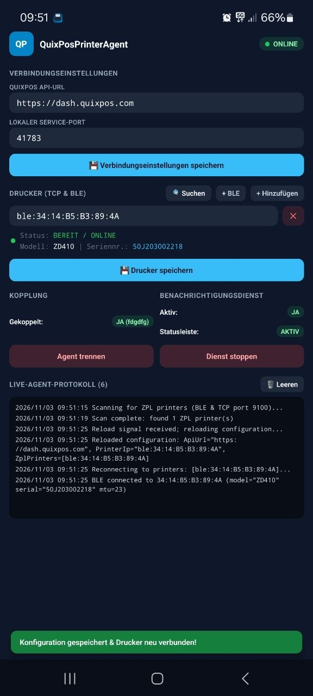
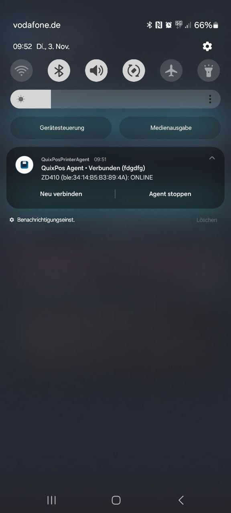
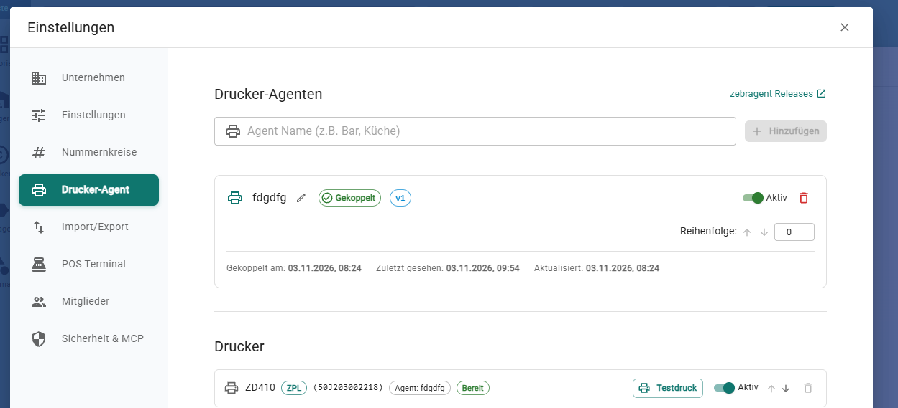

# QuixPos Printer Agent (Android)

Android background service bridging local Bluetooth Low Energy (BLE / ZPL) and network TCP (Port 9100) printers to the QuixPos cloud ([dash.quixpos.com](https://dash.quixpos.com)).

---

## Preview

| Android App UI | Background Service | QuixPos Dashboard |
| :---: | :---: | :---: |
|  |  |  |
| Realtime status & BLE / TCP scanner | Persistent background service & notification controls | Paired agent & printer management |

---

## Features

- **Multi-Printer Support:** Auto-discovery and manual configuration for network TCP (Port 9100) and Bluetooth LE (ZPL) printers.
- **Persistent Service:** Android foreground service keeping SSE live streams active with notification shade controls (*Neu verbinden*, *Agent stoppen*).
- **Edge-to-Edge UI:** Sleek, minimal dark UI respecting Android system insets, camera cutouts, and gesture navigation.
- **Local Monitor:** Built-in HTTP server (`:41783`) providing live JSON status snapshots.

---

## Quick Start

```sh
# Install dependencies
npm install

# Start Metro bundler
npm start

# Run on connected Android device
npm run android

# Build release APK
npm run build:apk
```
